# Visual eras

[← Daily profile](../README.md)

Explore every implemented theme at any time. Each preview keeps its own visual identity and shares the latest public statistics. Opening a preview does not change the daily profile.

11 themes · previews updated 2026-11-13 (UTC). Rows follow each theme’s light/dark appearance.

<!-- Generated from scripts/profile_themes.py; add themes to that catalog. -->
<table>
<tr><td>
<a href="phosphor/README.md"><picture>
  <source media="(prefers-color-scheme: dark)" srcset="phosphor/assets/row-dark.svg">
  
</picture></a>
</td></tr>
<tr><td>
<a href="desktop95/README.md"><picture>
  <source media="(prefers-color-scheme: dark)" srcset="desktop95/assets/row-dark.svg">
  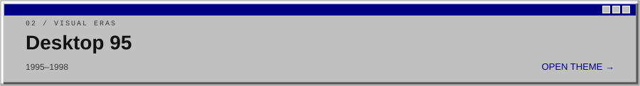
</picture></a>
</td></tr>
<tr><td>
<a href="construction/README.md"><picture>
  <source media="(prefers-color-scheme: dark)" srcset="construction/assets/row-dark.svg">
  
</picture></a>
</td></tr>
<tr><td>
<a href="matrix/README.md"><picture>
  <source media="(prefers-color-scheme: dark)" srcset="matrix/assets/row-dark.svg">
  
</picture></a>
</td></tr>
<tr><td>
<a href="y2k/README.md"><picture>
  <source media="(prefers-color-scheme: dark)" srcset="y2k/assets/row-dark.svg">
  
</picture></a>
</td></tr>
<tr><td>
<a href="aqua/README.md"><picture>
  <source media="(prefers-color-scheme: dark)" srcset="aqua/assets/row-dark.svg">
  
</picture></a>
</td></tr>
<tr><td>
<a href="aero/README.md"><picture>
  <source media="(prefers-color-scheme: dark)" srcset="aero/assets/row-dark.svg">
  
</picture></a>
</td></tr>
<tr><td>
<a href="metro/README.md"><picture>
  <source media="(prefers-color-scheme: dark)" srcset="metro/assets/row-dark.svg">
  
</picture></a>
</td></tr>
<tr><td>
<a href="material/README.md"><picture>
  <source media="(prefers-color-scheme: dark)" srcset="material/assets/row-dark.svg">
  
</picture></a>
</td></tr>
<tr><td>
<a href="glass/README.md"><picture>
  <source media="(prefers-color-scheme: dark)" srcset="glass/assets/row-dark.svg">
  
</picture></a>
</td></tr>
<tr><td>
<a href="field-notes/README.md"><picture>
  <source media="(prefers-color-scheme: dark)" srcset="field-notes/assets/row-dark.svg">
  
</picture></a>
</td></tr>
</table>
